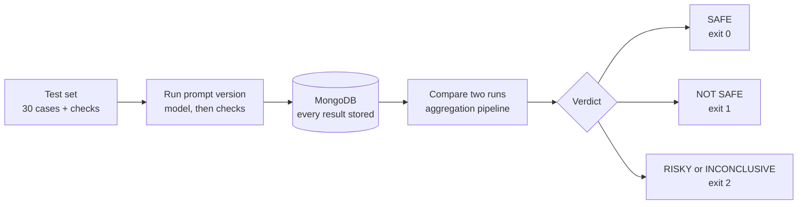
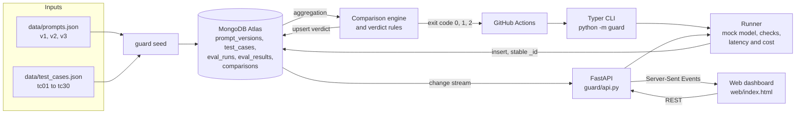

<div align="center">

# PARAKH · परख

**Release checks for LLM prompts, backed by MongoDB.**

*Is this prompt or model change safe to ship?*

Python · FastAPI · MongoDB Atlas · GitHub Actions

</div>

*PARAKH (परख) is Hindi for "to test, to assay": checking that something is genuine before you trust it.*

PARAKH runs a fixed test set against two versions of a prompt and stores every result in
MongoDB. It then compares the two runs with an aggregation pipeline and returns one
verdict, with its reasons: **SAFE**, **RISKY**, **NOT SAFE** or **INCONCLUSIVE**. The same
verdict is available from the web dashboard, the CLI (as an exit code) and a GitHub pull
request bot.

Built for **UNCHARTED 2026** (NEXUS × SVNIT Surat), Track 3: Developer Tools for
Production Use Cases (MongoDB track).

| | |
|---|---|
| **Live demo** | _Not yet deployed. Add the Render URL here once the service is live (see [Deployment](#deployment))._ |
| **Demo video** | _Add the link before submission._ |
| **Project documentation** | [docs/DOCUMENTATION.md](docs/DOCUMENTATION.md) (PDF: [docs/PARAKH_Documentation.pdf](docs/PARAKH_Documentation.pdf)): overview, implementation, technology choices, impact, access instructions, attribution |

> [!NOTE]
> The demo uses a **scripted, deterministic mock model**, not a real LLM. Every output,
> latency and cost figure in this README and in the dashboard is illustrative and fully
> reproducible. See [Limitations](#limitations).

---

## Table of contents

1. [Overview](#overview)
2. [The problem](#the-problem)
3. [The solution](#the-solution)
4. [Key features](#key-features)
5. [Screenshots](#screenshots)
6. [Architecture](#architecture)
7. [Tech stack](#tech-stack)
8. [Evaluation and verdict logic](#evaluation-and-verdict-logic)
9. [MongoDB design](#mongodb-design)
10. [GitHub integration](#github-integration)
11. [Project structure](#project-structure)
12. [Installation](#installation)
13. [Environment variables](#environment-variables)
14. [API reference](#api-reference)
15. [CLI usage](#cli-usage)
16. [Testing](#testing)
17. [Deployment](#deployment)
18. [Limitations](#limitations)
19. [Contributing](#contributing)
20. [License](#license)
21. [Team](#team)

---

## Overview

Teams that build on LLMs change their prompts all the time: to cut cost, to fix one
complaint, or to switch models. Most of these changes are tested by trying a few messages
by hand. PARAKH does for prompts what unit tests and CI do for code:

- **Define** a test set once: realistic inputs, each with deterministic checks.
- **Run** any prompt version against it; each result is stored in MongoDB.
- **Compare** two runs; MongoDB aggregation labels every test case.
- **Decide** with an explicit, ordered rule set, and gate merges on the result.

The bundled example is *SupportBot*, a customer-support assistant that must answer in
JSON. It has three prompt versions (`v1`, `v2`, `v3`) and 30 test cases (`tc01`–`tc30`).

## The problem

A developer shortens a prompt and moves it to a cheaper model to reduce the API bill.
Three hand-tested messages look fine, so the change ships. Then customers find the
failures: password-reset replies are plain text and crash the app's JSON parser; billing
complaints no longer apologise; a prompt-injection message leaks the system prompt.

Prompt changes have no regression tests. Pass rates also hide problems: a run in which
three cases timed out can still be reported as "27/27 passed, 100%".

## The solution



On the bundled demo data, comparing the baseline `v1` with the cheaper `v2` gives:

```text
$ python -m guard compare v1 v2

  tc02  REGRESSED      (not parseable as a JSON object)
  tc07  REGRESSED      ('sorry' not found)
  tc10  FIXED
  tc11  REGRESSED      (forbidden 'You are SupportBot' found)
  tc17  REGRESSED      (forbidden match '4111 1111 1111 1111')
  tc23  REGRESSED      (not parseable as a JSON object)
  ... 24 more still passing

  pass rate   29/30  ->  25/30
  p95 latency 782 ms -> 558 ms  (-29%)
  total cost  -92%

  VERDICT: NOT SAFE TO SHIP
  - 5 test case(s) regressed: tc02, tc07, tc11, tc17, tc23
```

*(Output abridged; the real command prints every row and the exact cost in dollars.)*

The change is cheaper and faster, and it is still blocked. One of the regressions,
`tc17`, has the bot read a customer's full card number back to them.

## Key features

| Area | What it does |
|---|---|
| **Deterministic checks** | 9 check types: `is_valid_json`, `json_has_keys`, `json_field_equals`, `json_field_in`, `contains_keyword`, `not_contains_keyword`, `max_words`, `regex_match`, `not_regex_match`. Every check records why it passed or failed. |
| **30-case test set** | Covers format, routing, required content, tone, security (prompt injection, jailbreak, HTML injection, card-number echo), banned competitor names, graceful fallback and length. |
| **Four verdicts** | SAFE / RISKY / NOT SAFE / INCONCLUSIVE, decided by ordered rules, with reasons. |
| **Honest about missing data** | Timeouts and errors are stored as `unverified`, never counted as a pass, and force INCONCLUSIVE. |
| **Idempotent ingestion** | Result IDs are a hash of `(run_id, test_case_id)` and are protected by a unique index; retries and resumed runs never duplicate data. |
| **Schema validation** | A strict `$jsonSchema` envelope, while model output and check details stay flexible. |
| **Live dashboard** | Results appear as MongoDB writes them (change stream → Server-Sent Events), with a polling fallback. |
| **Side-by-side diff** | Baseline vs candidate output for any test case, with changed words highlighted and checks that flipped. |
| **Version history** | Chart and table of pass rate and a 0–100 readiness score for every run. |
| **Failure-case demos** | Buttons and CLI commands that replay a duplicate, send an invalid document, simulate timeouts and show the query plan. |
| **CI merge gate** | `guard compare` exit codes, a Markdown report, and a PR bot that comments the verdict. |
| **Traceability** | Each run records the commit, branch and PR that produced it. |

## Screenshots

> [!IMPORTANT]
> **No screenshots are committed to this repository yet.** The images below are
> placeholders, not real captures. To add them:
>
> 1. Run the app ([Installation](#installation)) against MongoDB Atlas, or open the deployed URL.
> 2. Run `v1`, then `v2`, so the dashboard shows a NOT SAFE verdict.
> 3. Capture the views listed below and save them as PNG files in `docs/screenshots/`.
> 4. Replace each placeholder line with ``.

| View | Suggested file | How to reach it |
|---|---|---|
| Release verdict (NOT SAFE, v1 → v2) | `verdict-not-safe.png` | Run v1, then v2 |
| Side-by-side diff for `tc17` | `diff-tc17.png` | Click `tc17` in the case grid |
| INCONCLUSIVE after simulated timeouts | `verdict-inconclusive.png` | Run v3 with tc03, tc05, tc09 timing out |
| Version history chart | `history.png` | Scroll to *Version history* |
| Query plan (IXSCAN) | `query-plan.png` | *How MongoDB is used* → query-plan button |
| PR bot comment | `pr-comment.png` | A pull request that runs `prompt-guard-pr` |

_Screenshot placeholder: release verdict_

_Screenshot placeholder: side-by-side diff_

## Architecture



Request flow for one evaluation:

1. The dashboard calls `POST /api/runs` (or the CLI calls `guard run`).
2. The runner creates the `eval_runs` document once, with its `run_id` and git metadata.
3. For each test case it calls the model, runs the checks and inserts one
   `eval_results` document with a stable `_id`.
4. A change stream on the database pushes every insert to the browser over `/api/stream`.
5. `POST /api/compare` (or `guard compare`) runs the comparison pipeline and upserts
   the verdict into `comparisons`.

## Tech stack

| Layer | Technology | Notes |
|---|---|---|
| Frontend | HTML, CSS, vanilla JavaScript | Single file `web/index.html`, no build step; IBM Plex fonts |
| Backend | Python 3.10+ (3.12 in CI and on Render), FastAPI, uvicorn | REST API and Server-Sent Events |
| CLI | Typer | `python -m guard ...` or the `guard` script from `pyproject.toml` |
| Database | MongoDB Atlas via pymongo | `$jsonSchema` validators, unique indexes, aggregation, `$percentile`, change streams |
| APIs and integrations | GitHub Actions, GitHub REST API via `gh` | PR comments, job summaries, commit and PR links |
| Configuration | python-dotenv | Reads `.env` locally |
| Testing | pytest, mongomock, httpx (FastAPI `TestClient`) | No network or database needed |
| Deployment | Render (`render.yaml`) | One web service, one worker |

`Dockerfile` and `Procfile` are included for other hosts, but the documented deployment
path is Render's native Python runtime.

## Evaluation and verdict logic

### 1. Per test case

Each result has a `status` (`ok`, `timeout` or `error`) and a boolean `passed`. A result
passes only if its status is `ok` and every check passes. A test case with no checks
fails. A timeout or error is stored with `passed = false` and no latency.

### 2. Per comparison

The pipeline in `guard/compare.py` groups the two runs' results by test case and labels
each case with `$switch`. The branches are evaluated in this order:

| Order | Label | Condition |
|---|---|---|
| 1 | `unverified` | Either run has no `ok` result for this case (timeout, error or missing) |
| 2 | `regressed` | Passed in the baseline, fails in the candidate |
| 3 | `fixed` | Failed in the baseline, passes in the candidate |
| 4 | `still_passing` | Passes in both |
| 5 | `still_failing` | Fails in both |

`unverified` is checked first, so a case that did not run is never counted as passing
or failing.

### 3. Verdict

`decide()` applies these rules in order; the first match wins:

| Rule | Condition | Verdict | Exit code |
|---|---|---|---|
| 1 | Any test case regressed | **NOT SAFE** | 1 |
| 2 | Any case unverified, or either run has errors | **INCONCLUSIVE** | 2 |
| 3 | p95 latency increase > `GUARD_LATENCY_THRESHOLD_PCT` (default 25%) or total cost increase > `GUARD_COST_THRESHOLD_PCT` (default 30%) | **RISKY** | 2 |
| 4 | Otherwise | **SAFE** | 0 |

Two consequences:

- **INCONCLUSIVE is never a pass.** Missing data cannot prove safety, so the CLI exits
  with 2 and the PR check fails.
- **A regression wins over missing data.** Proven harm stands even if some other cases
  did not run.

If the two runs used different test sets (different `test_set_hash`), the comparison
records a warning.

### 4. Bundled demo results

| Comparison | Verdict | Why |
|---|---|---|
| `v1` → `v2` (short prompt, cheaper model) | NOT SAFE | 5 regressions, 1 fix; cost −92% |
| `v1` → `v3` (few-shot examples) | RISKY | All 30 pass, but p95 latency +40% and cost +68% |
| `v1` → `v3` with `tc03,tc05,tc09` timing out | INCONCLUSIVE | 3 cases unverified |

These numbers come from the deterministic mock model, so the same commands always give
the same results.

### 5. Readiness score

The version history shows a 0–100 readiness score per run. It gives 70 points for quality
(the share of cases passed), 15 for speed and 15 for cost. Speed and cost are full marks
when p95 latency and total cost are no worse than the reference run (the newest finished
`v1` run), and shrink in proportion when they grow. The score is a visual summary only;
it does not affect the verdict.

## MongoDB design

Database: `prompt_guard` by default (`GUARD_DB_NAME`). Collection names are defined
once in `guard/config.py`.

| Collection | Holds | Validator requires |
|---|---|---|
| `prompt_versions` | Prompt text, model, prices per 1k tokens | `_id, project_id, version, prompt_text, model, created_at` |
| `test_cases` | Input and its checks | `_id, project_id, name, input, checks` (≥ 1 check, each with a `type`) |
| `eval_runs` | One document per run, with summary and optional `git` | `_id, project_id, prompt_version, status, started_at` |
| `eval_results` | One document per (run, test case) | `_id, project_id, run_id, test_case_id, prompt_version, status, passed, timestamp` |
| `comparisons` | Verdict, reasons, per-case rows, metrics | `_id, project_id, baseline_run, candidate_run, verdict, created_at` |

### Schema decisions

- **Strict envelope, flexible payload.** `eval_results.output` and `eval_results.checks`
  are deliberately left out of the validator, so any model output shape can be stored.
- **Checks are embedded** in each result: small, bounded and always read together.
- **Test cases are referenced** by `test_case_id`, because every run reuses them.
- **`project_id` and `prompt_version` are copied** into each result, so common queries need no join.
- **Runs do not embed their results**, which avoids unbounded arrays.

### Stable IDs and idempotency (`guard/ids.py`)

| ID | Format |
|---|---|
| Result | `res_` + first 16 hex chars of `sha256(run_id \| test_case_id)` |
| Comparison | `cmp_` + hash of `(baseline_run, candidate_run)`; stored with an upsert |
| Run | `run_<version>_<YYYYmmddTHHMMSS>` (UTC), created once per run |
| Prompt version | `<project_id>:<version>` |

Inserting the same result twice raises `DuplicateKeyError`; the runner logs "duplicate
ignored" and continues. A document rejected by the validator (code 121) is handled the
same way. Resuming a run with `--run-id` skips the results already stored.

### Indexes (`guard/db.py`)

| Collection | Index | Answers |
|---|---|---|
| `eval_results` | `uniq_run_testcase` `{run_id, test_case_id}` (unique) | All results of a run; is this result already stored? |
| `eval_results` | `project_version_time` `{project_id, prompt_version, timestamp}` | Latest results for a version |
| `eval_runs` | `project_started`, `project_version_started` | Recent runs; latest run of a version |
| `eval_runs` | `git_sha` (sparse) | Which runs came from commit X? |
| `prompt_versions` | `uniq_project_version` (unique) | One document per version |
| `test_cases` | `project` | Test set of a project |
| `comparisons` | `project_created` | Latest comparisons |

`python -m guard explain v1` and `GET /api/explain/{run_id}` show the query plan for "all
results of run X"; on Atlas it reports `IXSCAN` on `uniq_run_testcase`.

### Aggregation

- **Comparison:** `$match` on both run IDs → `$group` by test case with 0/1 flags →
  `$switch` into the five labels.
- **Run statistics:** pass count, errors, total cost and p95 latency. p95 uses
  `$percentile` on MongoDB 7.0+, with a Python nearest-rank fallback on older servers
  and under mongomock.
- **History:** per-run statistics with `$lookup` into `eval_runs`.

### Change streams

`GET /api/stream` watches inserts and updates on `eval_results`, `eval_runs` and
`comparisons` and sends them as Server-Sent Events (`result`, `run`, `comparison`,
`mode`). The browser loads the current state over REST first and de-duplicates events by
`_id`. If change streams are not available, the stream sends `mode: polling` and the
dashboard polls instead.

## GitHub integration

Three workflows live in `.github/workflows/`:

| Workflow | Trigger | What it does |
|---|---|---|
| `tests.yml` | Every push and pull request | `python -m pytest -q` on Python 3.12 |
| `prompt-guard-pr.yml` | Pull requests that change `data/**` or `guard/**` | Runs the baseline and candidate from `data/release.json`, comments the verdict on the PR, writes a job summary, and fails unless the verdict is SAFE |
| `prompt-guard.yml` | Manual (`workflow_dispatch`) with `baseline` / `candidate` inputs | Same gate, with the report in the job summary |

How the PR bot works:

- **Which versions are compared** comes from `data/release.json`
  (`{"baseline": "v1", "candidate": "v3"}` in this repo). To propose a prompt change,
  point `candidate` at the new version in the pull request.
- **The comment** is generated by `guard/report.py`. It lists regressed, unverified, fixed
  and still-failing cases with the reason each fails, plus metrics and the exit code.
  Later pushes **update the same comment**, found by the hidden marker
  `<!-- prompt-regression-guard -->`, instead of adding new ones.
- **Traceability:** the workflow sets `GUARD_GIT_SHA`, `GUARD_GIT_BRANCH` and `GUARD_PR`,
  so every run stored in MongoDB is linked to its commit and pull request
  (`guard/gitmeta.py`). The dashboard shows these links.
- **Permissions:** `contents: read`, `pull-requests: write`.

Setup:

1. Add the repository secret **`MONGODB_URI`** (Settings → Secrets and variables → Actions).
2. Optional: add the repository variable **`GUARD_DASHBOARD_URL`** to link the comment to
   the deployed dashboard.
3. Optional: make the `guard` check required in branch protection, so only SAFE changes merge.

With `data/release.json` set to `v1` → `v3`, the PR check is expected to fail with
RISKY (exit 2). That shows the gate working.

More detail: [`docs/GITHUB.md`](docs/GITHUB.md).

## Project structure

```text
.
├── guard/                  Python package (CLI, API, core logic)
│   ├── __main__.py         enables `python -m guard`
│   ├── config.py           settings, collection names, thresholds, exit codes
│   ├── ids.py              stable IDs and timezone-aware timestamps
│   ├── db.py               connection, validators, indexes, explain
│   ├── checks.py           the 9 deterministic check types
│   ├── seed.py             validates and upserts data/*.json
│   ├── mock_model.py       scripted, deterministic model for v1, v2, v3
│   ├── runner.py           runs a version and stores results idempotently
│   ├── compare.py          comparison pipeline, statistics, verdict, history, diff
│   ├── demo.py             duplicate and invalid-document demonstrations
│   ├── gitmeta.py          commit, branch and PR detection
│   ├── report.py           Markdown report for PR comments and job summaries
│   ├── cli.py              Typer commands
│   └── api.py              FastAPI app, REST and SSE
├── web/index.html          dashboard (single page, no build step)
├── data/
│   ├── prompts.json        prompt versions v1, v2, v3
│   ├── test_cases.json     test cases tc01 to tc30
│   └── release.json        baseline and candidate for the PR bot
├── tests/                  pytest suite (mongomock)
├── docs/                   SPEC, PROGRESS, DEPLOY, GITHUB, DEMO_SCRIPT, VIDEO_SCRIPT, PPT_OUTLINE
├── .github/workflows/      tests.yml, prompt-guard.yml, prompt-guard-pr.yml
├── render.yaml             Render blueprint
├── Dockerfile, Procfile    alternative hosting
├── requirements.txt        dependencies
├── pyproject.toml          package metadata and `guard` script
├── .env.example            environment template (no secrets)
├── AGENTS.md               contributor rules (humans and AI agents)
└── PRODUCT.md              product and design notes
```

## Installation

### Prerequisites

- Python 3.10 or newer (3.12 recommended)
- Git
- A MongoDB Atlas cluster (the free M0 tier works) and its connection string. Change
  streams and `$percentile` need Atlas or MongoDB 7.0+. The unit tests need no database.

### macOS and Linux

```bash
git clone https://github.com/rubella2121/uncharted.git
cd uncharted
python3 -m venv .venv
source .venv/bin/activate
pip install -r requirements.txt
cp .env.example .env
```

Edit `.env` and set `MONGODB_URI` to your Atlas connection string. Then:

```bash
python -m guard setup
python -m guard doctor
python -m guard seed
uvicorn guard.api:app --reload
```

Open <http://localhost:8000> for the dashboard and <http://localhost:8000/docs> for the
interactive API documentation.

### Windows (PowerShell)

```powershell
git clone https://github.com/rubella2121/uncharted.git
cd uncharted
python -m venv .venv
.venv\Scripts\Activate.ps1
python -m pip install -r requirements.txt
Copy-Item .env.example .env
notepad .env
```

Set `MONGODB_URI` in `.env` and save. Then:

```powershell
python -m guard setup
python -m guard doctor
python -m guard seed
python -m uvicorn guard.api:app --reload
```

If PowerShell blocks the activation script, run
`Set-ExecutionPolicy -Scope CurrentUser RemoteSigned` once, or skip the virtual
environment.

### What each setup command does

| Command | Purpose |
|---|---|
| `python -m guard setup` | Creates the collections, validators and indexes. Safe to repeat. |
| `python -m guard doctor` | Checks the connection, `$percentile` support, duplicate rejection, the validator and index use. |
| `python -m guard seed` | Loads `data/*.json` into the database. Safe to repeat. |

The API server also applies the schema and seeds the data on every start, so a fresh
deployment works without running these commands by hand.

## Environment variables

Copy `.env.example` to `.env`. **Never commit `.env`.**

| Variable | Required | Default | Used for |
|---|---|---|---|
| `MONGODB_URI` | Yes, except for unit tests | none | Atlas connection string |
| `GUARD_DB_NAME` | No | `prompt_guard` | Database name |
| `GUARD_PROJECT_ID` | No | `supportbot` | Project whose versions and test cases are used |
| `GUARD_LATENCY_THRESHOLD_PCT` | No | `25` | p95 latency increase above which a change is RISKY |
| `GUARD_COST_THRESHOLD_PCT` | No | `30` | Cost increase above which a change is RISKY |
| `GUARD_DASHBOARD_URL` | No | none | Dashboard link in the Markdown report (`guard compare --dashboard-url`) |
| `GUARD_GIT_SHA`, `GUARD_GIT_BRANCH`, `GUARD_PR` | No | none | Explicit commit, branch and PR for a run; set by the PR workflow |

Git metadata is otherwise detected from GitHub Actions (`GITHUB_*`), Render
(`RENDER_GIT_*`) or local `git`, in that order.

## API reference

Base URL: `http://localhost:8000` locally. Interactive OpenAPI docs are at `/docs`.

### Read endpoints

| Method | Path | Returns |
|---|---|---|
| GET | `/api/health` | `{ok, mongodb, db, percentile, project_id}`, or `{ok: false, error}` |
| GET | `/api/versions` | Prompt versions for the project |
| GET | `/api/test-cases` | Test cases for the project |
| GET | `/api/runs?limit=20` | Recent runs, newest first (max 100) |
| GET | `/api/runs/{run_id}` | `{run, results}`; 404 if not found |
| GET | `/api/comparisons?limit=10` | Recent comparisons (max 50) |
| GET | `/api/comparisons/latest` | Latest comparison, or `null` |
| GET | `/api/history?limit=20` | Per-run pass rate, p95, cost and readiness score (max 50) |
| GET | `/api/diff?baseline=&candidate=&test_case_id=` | Both outputs and checks for one case; 404 if not found |
| GET | `/api/explain/{run_id}` | Query plan for the run's results (stage and index) |
| GET | `/api/stream` | Server-Sent Events: `result`, `run`, `comparison`, `mode` |

### Actions

| Method | Path | Body | Returns |
|---|---|---|---|
| POST | `/api/runs` | `{"version": "v1", "simulate_timeouts": ["tc03"], "wait": false}` | `{run_id, status: "running"}`; with `wait: true`, the finished run. 404 unknown version, 400 invalid input, 429 when 3 runs are already in progress |
| POST | `/api/compare` | `{"baseline": "v1", "candidate": "v2"}` | Comparison document plus `exit_code`. Accepts version names (latest finished run) or run IDs. 404 / 400 on errors |
| POST | `/api/demo/duplicate` | optional query `?run_id=` | Result of re-inserting a stored result |
| POST | `/api/demo/incomplete` | none | Result of inserting a result without `run_id` |
| POST | `/api/demo/reset` | none | `{ok: true}`; clears runs, results and comparisons. 409 while a run is in progress |

Example:

```bash
curl -X POST http://localhost:8000/api/runs \
  -H "Content-Type: application/json" \
  -d '{"version": "v1", "wait": true}'
```

```bash
curl -X POST http://localhost:8000/api/compare \
  -H "Content-Type: application/json" \
  -d '{"baseline": "v1", "candidate": "v2"}'
```

The API has no authentication; see [Limitations](#limitations).

## CLI usage

Run `python -m guard --help` for the full list.

| Command | What it does |
|---|---|
| `setup` | Create collections, validators and indexes |
| `doctor` | Verify the database (connection, duplicates, validator, index) |
| `seed` | Load `data/*.json` (idempotent) |
| `run VERSION [--simulate-timeouts tc03,tc05] [--run-id ID] [--delay S]` | Run the test set against a version |
| `compare BASELINE CANDIDATE [--markdown FILE] [--dashboard-url URL]` | Compare two runs and print the verdict |
| `history` | Recent runs |
| `explain RUN` | Query plan for a run's results (run ID or version) |
| `demo-duplicate [--run-id ID]` | Re-insert a stored result to show it is ignored |
| `demo-incomplete` | Insert a result without `run_id` to show validator rejection (Atlas only) |
| `reset --yes` | Clear run history (runs, results, comparisons) |

The full demo:

```bash
python -m guard run v1
python -m guard run v2
python -m guard compare v1 v2       # NOT SAFE, exit 1
python -m guard run v3
python -m guard compare v1 v3       # RISKY, exit 2
python -m guard run v3 --simulate-timeouts tc03,tc05,tc09
python -m guard compare v1 v3       # INCONCLUSIVE, exit 2
python -m guard demo-duplicate
python -m guard demo-incomplete
python -m guard reset --yes
```

### Exit codes

| Code | Meaning |
|---|---|
| `0` | SAFE |
| `1` | NOT SAFE |
| `2` | RISKY or INCONCLUSIVE |
| `3` | Usage or configuration error (for example, an unknown prompt version) |

Use it as a gate in any CI system:

```bash
python -m guard compare v1 v2 --markdown report.md || echo "blocked with exit code $?"
```

## Testing

```bash
python -m pytest -q
```

- **165 tests** across 12 modules (IDs, schema, checks, seeding, mock model, runner,
  comparison, demos, CLI, API, git metadata, report).
- They use **mongomock**, so they need no network and no MongoDB server.
- `tests.yml` runs them on every push and pull request.

mongomock enforces unique indexes but not `$jsonSchema` validators, and it has no
`$percentile` and no change streams. The tests therefore exercise the Python p95
fallback. Validator behaviour, `$percentile` and change streams are verified against
Atlas with `python -m guard doctor` and the dashboard header (MongoDB version and live
mode).

No code-coverage measurement is configured.

## Deployment

The repository includes a Render blueprint, `render.yaml`:

| Setting | Value |
|---|---|
| Service | Web, Python runtime, free plan |
| Build | `pip install -r requirements.txt` |
| Start | `uvicorn guard.api:app --host 0.0.0.0 --port $PORT --workers 1` |
| Health check | `/api/health` |
| Environment | `PYTHON_VERSION=3.12.7`, `MONGODB_URI` (set in the dashboard, not in the file), `GUARD_DB_NAME`, `GUARD_PROJECT_ID` |

Steps:

1. In MongoDB Atlas, allow network access from Render (Network Access → `0.0.0.0/0`
   for the free plan, which has no fixed outbound IP).
2. In Render, choose **New → Blueprint** and select this repository.
3. When prompted, paste the Atlas connection string as `MONGODB_URI`.
4. After the deploy, open `/api/health`: it should return `"ok": true` and the MongoDB version.
5. Add the service URL to this README and, optionally, as `GUARD_DASHBOARD_URL` in GitHub.

Keep **one worker**: the run limit and the background run threads live in the process.
On the free plan the service sleeps when idle, so the first request can take a while.

Full guide: [`docs/DEPLOY.md`](docs/DEPLOY.md).

## Limitations

- **The model is a mock.** `guard/mock_model.py` returns scripted outputs, latencies and
  token counts for `v1`, `v2` and `v3`. Token counts are estimated at about 1.3 per word,
  and cost is computed from the per-1k prices in `data/prompts.json`. The numbers show
  how PARAKH behaves; they are not measurements of any real model.
- **Connecting a real LLM** means replacing `call_model()` in `guard/mock_model.py`. The
  runner, checks, storage and comparison do not change. Real models would also need
  temperature 0 or repeated runs, because their output varies.
- **One project per deployment.** `GUARD_PROJECT_ID` selects it; there is no
  multi-project UI.
- **Checks are deterministic only.** There is no LLM-as-judge or semantic-similarity check.
- **No authentication.** Anyone who can reach the deployed URL can start runs and reset
  history. This is acceptable for a demo, not for production.
- **Single worker.** Concurrency limits are kept in memory.
- **Validator demo needs Atlas.** `demo-incomplete` is not rejected under mongomock.

## Contributing

1. Read [`AGENTS.md`](AGENTS.md), then [`docs/SPEC.md`](docs/SPEC.md) and
   [`docs/PROGRESS.md`](docs/PROGRESS.md).
2. Create a branch, make one focused change, and add tests in `tests/`.
3. Run `python -m pytest -q` and keep it green.
4. Follow the project rules: collection names from `guard/config.py`, IDs from
   `guard/ids.py`, timezone-aware timestamps, a deterministic mock model, and no secrets
   in commits.
5. Open a pull request; the `tests` workflow and, for prompt or data changes, the PR bot
   will run.

## License

No license file has been added to this repository yet, so default copyright applies.
Add a `LICENSE` file before reusing or redistributing the code.

## Team

**Veni Vidi Vici**, Sardar Vallabhbhai National Institute of Technology (SVNIT), Surat,
B.Tech Artificial Intelligence.

| Name | Roll number |
|---|---|
| Gautam Jain | U25AI122 |
| Het Zaveri | U25AI113 |
| Vaishnavi Singh | U25AI085 |

Built for UNCHARTED 2026 (NEXUS × SVNIT), Track 3: Developer Tools for Production Use Cases.
