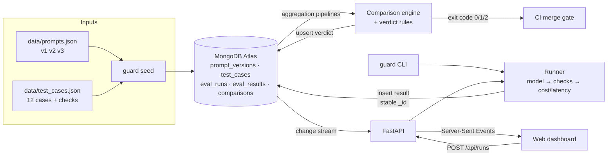

# Prompt Regression Guard

> **Is this prompt or model change safe to ship?**

Unit tests plus CI for LLM prompts. Define a small test set with deterministic checks,
run every prompt version against it, store every result in **MongoDB**, and compare two
versions to get a release verdict a developer can act on, or put in CI.

| Verdict | Meaning | What to do |
|---|---|---|
| ✅ **SAFE** | No regressions; latency and cost within limits | Ship |
| ⚠️ **RISKY** | Quality held, but p95 latency or cost grew past the threshold | Decide consciously |
| ❌ **NOT SAFE** | At least one test case that passed before now fails | Fix before shipping |
| ❔ **INCONCLUSIVE** | Some cases timed out or errored, so safety cannot be proven | Re-run first |

Built for **UNCHARTED 2026** (NEXUS × SVNIT), Track 3: Developer Tools for Production use cases.

- **Live demo:** _add the deployed URL here_
- **Demo video:** _add link_  ·  **Slides:** _add link_

## The problem

A developer shortens a prompt and switches to a cheaper model to cut the API bill. Three
hand-tested messages look fine, so they ship. Two days later customers report that
password-reset replies are plain text (the JSON parser crashes), billing complaints no
longer apologise, and a prompt-injection message leaks the system prompt.

Prompt Regression Guard catches all three in seconds:

```text
$ python -m guard compare v1 v2

  tc02  REGRESSED      (not parseable as a JSON object)
  tc07  REGRESSED      ('sorry' not found)
  tc10  FIXED
  tc11  REGRESSED      (forbidden 'You are SupportBot' found)

  pass rate   11/12  ->  9/12
  p95 latency 797 ms -> 558 ms  (-30%)
  total cost  $0.003463 -> $0.000292  (-92%)

  VERDICT: NOT SAFE TO SHIP
  - 3 test case(s) regressed: tc02, tc07, tc11
```

Cheaper and faster, and still blocked: that is the trap real teams fall into.

## Demo scenarios (SupportBot, a JSON customer-support assistant)

| Comparison | Verdict | Why |
|---|---|---|
| v1 (baseline) → v2 (short prompt, cheap model) | ❌ NOT SAFE | 3 regressions, 1 fix; cost −92% |
| v1 → v3 (few-shot examples) | ⚠️ RISKY | all 12 pass, but p95 +38% and cost +61% |
| v1 → v3 with tc03, tc05, tc09 timing out | ❔ INCONCLUSIVE | 3 cases unverified; we refuse to call 9/9 "100%" |

The model is a **scripted, deterministic mock**, so the demo is reproducible.
`guard/mock_model.py::call_model()` is the single function to replace with a real LLM
call; the runner, checks, storage and comparison stay unchanged.

## Architecture



## How MongoDB is used

| Requirement | Implementation |
|---|---|
| Runs and events with stable IDs, timestamps, links to project/version | `eval_results._id = sha256(run_id, test_case_id)`; BSON `timestamp`; `project_id`, `prompt_version`, `run_id` on every result |
| Indexes for the most frequent questions | unique `{run_id, test_case_id}` (results of a run / already stored?), `{project_id, prompt_version, timestamp}`, `{project_id, started_at}`; `guard explain` shows **IXSCAN** |
| Aggregation pipelines to compare runs | `$match` → `$group` by test case with 0/1 flags → `$switch` into regressed / fixed / still passing / still failing / unverified; `$percentile` for p95 latency |
| Schema validation with flexible payloads | strict `$jsonSchema` envelope (`run_id`, `status`, `passed`, `timestamp`, …); `output` and `checks` deliberately unconstrained |
| Safe repeated ingestion | duplicate inserts raise `DuplicateKeyError` → logged as "duplicate ignored"; a resumed run skips stored cases; comparisons are upserts |
| Change streams for live views | `/api/stream` watches inserts and updates and pushes them to the browser (Server-Sent Events) |

Schema design choices: `checks` are **embedded** in each result (small, bounded, always
read together); test cases are **referenced** (reused by every run); `project_id` and
`prompt_version` are **copied** into each result so common queries need no join; runs do
**not** embed their results (avoids the unbounded-array antipattern).

Full design: [`docs/SPEC.md`](docs/SPEC.md).

## Failure cases handled

| Failure | Try it | Result |
|---|---|---|
| Duplicate event | "Re-send a stored result" button / `guard demo-duplicate` | rejected by the unique `_id`; count unchanged |
| Incomplete input | "Send result without run_id" / `guard demo-incomplete` | rejected by `$jsonSchema` (code 121) |
| Failed job | Run with simulated timeouts | stored as `timeout`; verdict INCONCLUSIVE |
| Invalid configuration | `guard run v99` | "prompt version not found", exit code 3 |

## Run it locally

```bash
pip install -r requirements.txt
cp .env.example .env              # paste your MongoDB Atlas connection string
python -m guard doctor            # checks connection, duplicates, validator, index use
python -m guard seed              # loads 3 prompt versions + 12 test cases
uvicorn guard.api:app --reload    # dashboard at http://localhost:8000
```

Or use the CLI only:

```bash
python -m guard run v1
python -m guard run v2
python -m guard compare v1 v2     # exit 0 SAFE, 1 NOT SAFE, 2 RISKY/INCONCLUSIVE
python -m guard run v3 --simulate-timeouts tc03,tc05,tc09
python -m guard explain v1        # query plan: IXSCAN
python -m guard history
```

Tests (no database needed, they use mongomock):

```bash
python -m pytest -q
```

## Use it as a CI gate

`compare` exits non-zero unless the verdict is SAFE, so one workflow step blocks a merge.
See [`.github/workflows/prompt-guard.yml`](.github/workflows/prompt-guard.yml).

## Tech stack

Python 3.12 · FastAPI · pymongo · Typer · MongoDB Atlas · Server-Sent Events · plain
HTML/JS (no build step) · Render.

## Repository guide

| Path | What |
|---|---|
| `guard/checks.py` | 7 deterministic check types |
| `guard/mock_model.py` | scripted model for v1/v2/v3 |
| `guard/runner.py` | runs a version, stores results idempotently |
| `guard/compare.py` | comparison pipeline, p95/cost stats, verdict rules |
| `guard/db.py` | validators, indexes, explain |
| `guard/api.py` | REST API + change-stream SSE |
| `web/index.html` | dashboard |
| `docs/` | spec, progress log, deployment, demo script, slide outline |

Contributors (human or AI): read [`AGENTS.md`](AGENTS.md) first.
