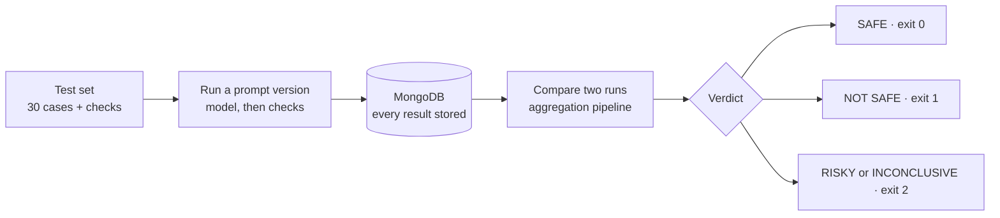
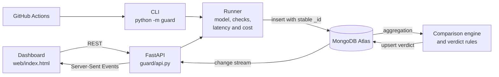

# PARAKH: project documentation

**UNCHARTED 2026** (NEXUS × SVNIT Surat, in collaboration with MongoDB and n8n) ·
Track 3: Developer Tools for Production Use Cases

This document is the project documentation required for judging ("Demo & documentation",
section 9 of the Participant Rulebook). It follows the rulebook's mandatory submission
items (section 6) and final checklist (section 16). Setup commands and the full API and
CLI reference are in the [README](../README.md); this document explains the project.

| Item | Where |
|---|---|
| Live deployment | _Add the Render URL here after deploying (see [DEPLOY.md](DEPLOY.md))._ |
| GitHub repository | <https://github.com/rubella2121/uncharted> |
| Demo video (≤ 7 min) | _Add the link before submission._ |
| Presentation deck | _Add the link before submission._ |

---

## 1. Team details

**Team name:** Veni Vidi Vici

**Institute:** Sardar Vallabhbhai National Institute of Technology (SVNIT), Surat, B.Tech Artificial Intelligence

| Member | Roll number |
|---|---|
| Gautam Jain | U25AI122 |
| Het Zaveri | U25AI113 |
| Vaishnavi Singh | U25AI085 |

The team has exactly three members, as section 4 of the rulebook requires.

## 2. Project overview

| Field | Answer |
|---|---|
| **Project title** | PARAKH (परख, Hindi for "to test, to assay") |
| **One line** | Is this prompt or model change safe to ship? |
| **Problem** | Teams that build on LLMs change prompts and models all the time, but test those changes by hand with a few messages. Regressions reach users first. |
| **Solution** | Unit tests and CI for prompts: run a fixed test set against two prompt versions, store every result in MongoDB, compare the runs with an aggregation pipeline, and return one verdict with reasons: SAFE, RISKY, NOT SAFE or INCONCLUSIVE. |
| **Main features** | 30-case test set with 9 deterministic check types; four ordered verdicts; live dashboard over MongoDB change streams; side-by-side output diff; version history with a readiness score; idempotent ingestion and schema validation; CLI exit codes for CI; a GitHub pull-request bot. |

## 3. The problem

A developer shortens a prompt and moves it to a cheaper model to cut the API bill. Three
hand-tested messages look fine, so the change ships. Then customers find the failures:
replies that should be JSON are plain text and crash the app's parser, billing complaints
no longer apologise, a prompt-injection message leaks the system prompt, and the bot reads
a customer's card number back to them.

Two things make this hard in practice:

1. **Prompts have no regression tests.** Nobody re-checks the cases that used to work.
2. **Pass rates hide missing data.** A run where three cases timed out can still be shown
   as "27/27 passed, 100%".

## 4. The solution

1. **Define** the test set once. Each case is a realistic support message with automatic
   checks (valid JSON, routing category, required words, banned words, no leaked data,
   length limits).
2. **Run** any prompt version against it. Each result is stored with a stable ID.
3. **Compare** a baseline run with a candidate run. MongoDB labels every case as
   regressed, fixed, still passing, still failing or unverified.
4. **Decide** with fixed, ordered rules, and show the reasons.
5. **Gate** the change: the same verdict appears on the dashboard, as a CLI exit code, and
   as a comment on the GitHub pull request.

### Verdict rules

Applied in order; the first match wins.

| Order | Condition | Verdict | Exit code |
|---|---|---|---|
| 1 | Any case that passed in the baseline fails in the candidate | **NOT SAFE** | 1 |
| 2 | Any case timed out or errored (unverified) | **INCONCLUSIVE** | 2 |
| 3 | p95 latency up more than 25%, or total cost up more than 30% | **RISKY** | 2 |
| 4 | Otherwise | **SAFE** | 0 |

INCONCLUSIVE is never treated as a pass: missing data cannot prove safety. A regression
wins over missing data, because proven harm stands.

### Results on the bundled demo

| Comparison | Verdict | Why |
|---|---|---|
| v1 (baseline) → v2 (short prompt, cheaper model) | NOT SAFE | 5 regressions (tc02, tc07, tc11, tc17, tc23), 1 fix; cost −92% |
| v1 → v3 (few-shot examples) | RISKY | All 30 pass, but p95 latency +40% and cost +68% |
| v1 → v3 with tc03, tc05, tc09 timing out | INCONCLUSIVE | 3 cases unverified |
| v1 → v1 (a second run) | SAFE | Nothing changed |

These figures come from a scripted, deterministic mock model (see section 10), so anyone
running the same steps gets the same results.

## 5. Implementation

### Architecture

### Modules

| Module | Responsibility |
|---|---|
| `guard/checks.py` | 9 deterministic check types; each check returns whether it passed and why |
| `guard/mock_model.py` | Scripted, seeded model outputs for prompt versions v1, v2, v3 |
| `guard/runner.py` | Runs a version, records latency, tokens and cost, stores results idempotently, resumes interrupted runs |
| `guard/compare.py` | Comparison pipeline, p95 and cost statistics, verdict rules, history, diff |
| `guard/db.py` | Collections, `$jsonSchema` validators, indexes, query-plan explain |
| `guard/api.py` | REST API and live updates (change stream → Server-Sent Events, polling fallback) |
| `guard/cli.py` | Typer CLI with CI exit codes |
| `guard/gitmeta.py`, `guard/report.py` | Commit and PR metadata; Markdown report for PR comments |
| `web/index.html` | Single-page dashboard in plain HTML, CSS and JavaScript (no build step) |

### How MongoDB is used

MongoDB is the system of record, not just storage. Each guarantee below can be tried from
the dashboard.

| Capability | How PARAKH uses it | Try it |
|---|---|---|
| **Stable IDs + unique index** | Each result's `_id` is a hash of `(run_id, test_case_id)`, backed by a unique index. Retries and resumed runs never create duplicates. | *Re-send a stored result*: ignored, count unchanged |
| **Schema validation** | A strict `$jsonSchema` envelope (`run_id`, `status`, `passed`, `timestamp`…) while model `output` and `checks` stay flexible | *Send a result without run_id*: rejected (code 121) |
| **Aggregation** | `$group` + `$switch` labels every case; `$percentile` gives p95 latency; `$lookup` builds the version history | Every verdict and the history chart |
| **Change streams** | The dashboard updates as MongoDB writes each result | Run any version and watch rows arrive |
| **Indexes** | Results by run, latest results per version, recent runs, runs by commit | *Show query plan*: `IXSCAN`, not a collection scan |
| **Persistent history** | Every run and verdict is kept, so any two runs can be compared later | Run history and version history panels |

Schema decisions: checks are **embedded** in each result (small, always read together);
test cases are **referenced** (reused by every run); runs do **not** embed results
(avoids unbounded arrays). Full design: [SPEC.md](SPEC.md).

### Failure handling

| Failure | Result |
|---|---|
| Duplicate event | Rejected by the unique `_id`; logged as "duplicate ignored" |
| Incomplete document | Rejected by the validator; logged, not fatal |
| Model timeout or error | Stored as `timeout` / `error`, counted as unverified; verdict becomes INCONCLUSIVE |
| Unknown prompt version | Clear error; CLI exit code 3; API 404 |
| Interrupted run | Resuming with the same run ID skips results already stored |
| Change streams unavailable | Dashboard falls back to polling and says so |

### Quality

- **165 automated tests** (`python -m pytest -q`) across 12 test modules, run on every
  push by GitHub Actions. They use mongomock, so they need no network.
- Validator behaviour, `$percentile`, change streams and index use are verified against
  Atlas with `python -m guard doctor` (the team verified them on MongoDB 8.0).
- The dashboard targets WCAG 2.1 AA: keyboard operation, visible focus, and pass / fail /
  unverified never shown by colour alone.

## 6. Technology choices

| Choice | Why |
|---|---|
| **MongoDB Atlas** | Results have a fixed envelope but a flexible payload (any model output shape). Validators enforce the envelope; unique indexes make ingestion idempotent; aggregation does the comparison inside the database; change streams power the live view. |
| **Python + FastAPI** | One language for checks, runner, API and CLI; FastAPI gives typed request models and interactive API docs at `/docs`. |
| **pymongo** | The official driver, with direct access to aggregation, change streams and explain. |
| **Typer CLI** | The same verdict in a terminal or CI, with exit codes 0 / 1 / 2 as a merge gate. |
| **Plain HTML + JavaScript** | No build step, so the dashboard deploys with the API and is easy to audit. |
| **GitHub Actions** | Tests on every push; a PR bot that comments the verdict and fails unless SAFE. |
| **Render** | One-click deploy from `render.yaml`, one worker, health check at `/api/health`. |
| **Deterministic checks, not LLM-as-judge** | Reproducible verdicts that never change between runs of the same output. |

## 7. Key features in the dashboard

1. **Run a version** with optional simulated timeouts, and auto-compare with the baseline.
2. **Release verdict** stamped in its own colour, with the two runs compared, reasons,
   and pass-rate, latency and cost changes drawn against their limits.
3. **Tasting line** of all 30 cases (baseline → candidate) and a **side-by-side diff** of
   any case, with changed words and flipped checks.
4. **Results table** with the reason each check failed, and expandable input and output.
5. **Run history** linked to the commit and pull request that produced each run.
6. **Version history chart** of readiness score and pass rate, with a table view.
7. **Failure handling** buttons, **How MongoDB is used** with a live query plan, and a
   **live event log** of database events.

## 8. Access instructions for judges

- **No login is required.** Open the live URL; there are no accounts or test credentials.
- The free Render plan sleeps when idle, so the **first load can take up to a minute**.
- Suggested two-minute path:
  1. Click **Reset run history** (it asks to confirm) for a clean start.
  2. Select **v1** and click **Run evaluation**: 29/30 pass.
  3. Select **v2** and run it: the verdict is **NOT SAFE TO SHIP**; the first regression's
     diff opens automatically. Select **tc17** to see the leaked card number.
  4. Run **v3**: **RISKY** (all pass, but slower and more expensive).
  5. Open **Simulate timeouts**, tick tc03, tc05, tc09, run **v3** again: **INCONCLUSIVE**.
  6. Try **Re-send a stored result**, **Send a result without run_id** and
     **Show query plan**.
- Interactive API documentation is at `/docs` on the same URL.

## 9. Impact

- **Developers** catch prompt regressions before merging, and see exactly which case
  broke and why.
- **Teams** can cut model costs safely, with a stored history of every prompt version.
- **End users** stop receiving broken replies or having their data read back to them.
- **CI** gets a machine-readable gate (exit codes, PR comment) that refuses to call a
  change safe when evidence is missing.

## 10. Limitations

- **The model is a mock.** `guard/mock_model.py` returns scripted outputs, latencies and
  token counts so the demo is reproducible. Latency and cost figures are illustrative,
  not measurements of a real LLM, and the dashboard labels them as such. Connecting a
  real model means replacing one function, `call_model()`; real models would also need
  temperature 0 or repeated runs.
- **One project per deployment** (`GUARD_PROJECT_ID`).
- **Deterministic checks only**: no semantic-similarity or LLM-as-judge checks.
- **No authentication**: anyone with the URL can start runs and reset history. Acceptable
  for a judged demo, not for production.
- **Single worker**: run limits are kept in memory.

## 11. Originality, attribution and AI use

Section 5 of the rulebook asks teams to disclose pre-existing code, attribute third-party
components and follow the AI-use policy.

- **Built during the event.** The repository's first commit is at 00:20 IST on
  31 October 2026, inside the build window (30 Oct 9:00 PM to 31 Oct 9:00 PM IST). No
  pre-existing project code or templates were used. The commit history is public.
- **Data.** The 30 test cases and three prompt versions in `data/` were written for this
  project. They describe a fictional support assistant, "SupportBot". The card number in
  `tc17` is a standard public test number (4111 1111 1111 1111), not real data.
- **AI assistance.** The team used Claude Code (Anthropic) as a coding assistant during
  development, and the Impeccable design skill for the dashboard's design review. The
  team directed the work and is responsible for understanding and testing it; every
  change is covered by the test suite and visible in the commit history.

### Third-party components

| Component | Use | Licence |
|---|---|---|
| FastAPI | Web API | MIT |
| uvicorn | ASGI server | BSD-3-Clause |
| pymongo | MongoDB driver | Apache-2.0 |
| Typer | CLI | MIT |
| python-dotenv | `.env` loading | BSD-3-Clause |
| pytest | Tests | MIT |
| mongomock | In-memory MongoDB for tests | ISC |
| httpx | Test client | BSD-3-Clause |
| Geist, Geist Mono | Dashboard typefaces (Google Fonts) | SIL Open Font License 1.1 |
| Tiro Devanagari Hindi | परख wordmark (Google Fonts) | SIL Open Font License 1.1 |
| MongoDB Atlas, Render, GitHub Actions | Hosting, deployment, CI | Used under their terms of service |

Icons and the brand mark are drawn in the project's own inline SVG.

## 12. Security

- No API keys, passwords or connection strings are committed. Configuration comes from
  environment variables; only `.env.example` (with placeholders) is in the repository, and
  `.env` is ignored by git.
- The Atlas connection string is stored as a Render environment variable and a GitHub
  Actions secret (`MONGODB_URI`), never in code, slides or the demo video.
- No private user data is used; all test data is fictional.

## 13. Submission checklist (rulebook section 16)

| Item | Status |
|---|---|
| Exactly three eligible SVNIT members | Yes (section 1) |
| Follows the problem statement (Track 3) and event rules | Yes |
| Deployed, core functionality works | Deploy on Render, then fill in the URL at the top |
| GitHub repository correct and accessible | Public: <https://github.com/rubella2121/uncharted> |
| README explains the project, setup and key technologies | Yes: [README.md](../README.md) |
| Demo video ≤ 7 minutes | Script: [VIDEO_SCRIPT.md](VIDEO_SCRIPT.md); record on the deployed URL |
| PPT covers problem, solution, implementation, technology choices, impact | Yes (8 slides) |
| Access instructions | Section 8 (no login needed) |
| All form fields complete, links checked | Before 10:00 PM IST on 31 October |
| Code freeze understood | No commits or changes after 9:00 PM IST on 31 October |

## 14. Related documents

| Document | Contents |
|---|---|
| [README.md](../README.md) | Installation (incl. Windows), environment variables, API and CLI reference |
| [SPEC.md](SPEC.md) | Full design: data model, IDs, pipelines, verdict rules |
| [DEPLOY.md](DEPLOY.md) | Deployment on Render with MongoDB Atlas |
| [GITHUB.md](GITHUB.md) | GitHub Actions merge gate and PR bot setup |
| [DEMO_SCRIPT.md](DEMO_SCRIPT.md), [VIDEO_SCRIPT.md](VIDEO_SCRIPT.md) | Live demo and video scripts |
| [PROGRESS.md](PROGRESS.md) | Step-by-step build log |
